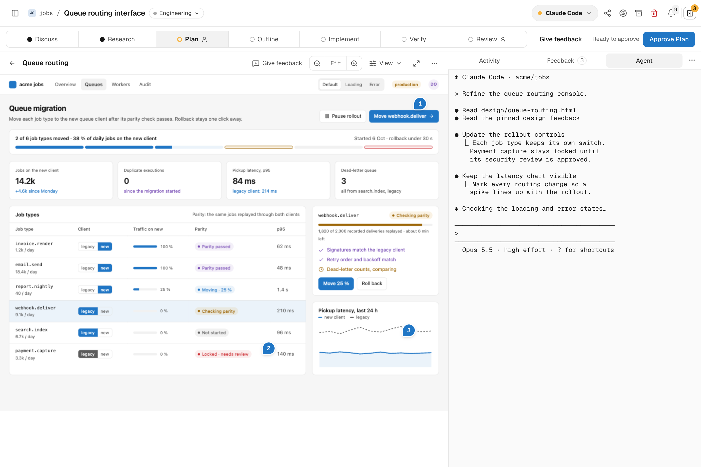

<div align="center">

<picture>
  <source media="(prefers-color-scheme: dark)" srcset="docs/site/public/brand/qualitylayer-mark.svg">
  
</picture>

# QualityLayer

A planning-first workflow for the Claude Code or Codex you already use.

[Download the App](https://qualitylayer.dev/download) · [Documentation](https://qualitylayer.dev/docs/) · [Website](https://qualitylayer.dev) · [Releases](https://github.com/maxritter/pilot-shell/releases)

</div>

QualityLayer helps you agree on a coding change before your agent builds it, then review the evidence for the finished work. You approve the plan and the result. Your agent researches the code, builds in small slices and checks the change against your request.

QualityLayer runs only when you ask for it. Each step stays in a Markdown file in your repository, alongside the designs and review records.

<picture>
  <source media="(max-width: 600px) and (prefers-color-scheme: dark)" srcset="docs/site/public/product/plan-phone-dark.webp">
  <source media="(max-width: 600px)" srcset="docs/site/public/product/plan-phone-light.webp">
  <source media="(prefers-color-scheme: dark)" srcset="docs/site/public/product/plan-dark.webp">
  
</picture>

Screenshots show illustrative task data.

<details>
<summary>Watch the five-minute walkthrough</summary>

<a href="https://qualitylayer-media.max-ritter.workers.dev/overview.mp4"></a>

</details>

## Plan, build and review

### Agree on the change

- Your agent asks about the outcome, reproduces a bug when needed, and reads how your code works today.
- The Plan brings together the design, technical decisions and checks. You can comment on a passage or ask for changes before approving it.

### Build from the approved plan

- Your agent splits the work into small slices and starts each slice with a failing test.
- The App shows what is running and what needs your attention. Routine technical choices stay with the agent and are recorded.
- An agent that did not write the code checks the running result against every point of your request. Failed checks lead to fixes and another check.

### Read the result

- Review shows why the change was made, the files and diffs, what was checked, and any remaining decisions for you.
- You approve the finished change. Approval does not merge a pull request or switch a branch.
- The task stays open while the pull request needs review or has failing checks; it closes when you merge.

<details>
<summary>The seven steps</summary>

| Step | What happens |
|---|---|
| [Discuss](https://qualitylayer.dev/docs/steps/discuss) | Agree on what done means; reproduce a bug first |
| [Research](https://qualitylayer.dev/docs/steps/research) | Read how the code works today |
| [Plan](https://qualitylayer.dev/docs/steps/plan) | Review the design and decisions; approve the plan |
| [Outline](https://qualitylayer.dev/docs/steps/outline) | Split the approved plan into buildable slices |
| [Implement](https://qualitylayer.dev/docs/steps/implement) | Build each slice, starting with a failing test |
| [Verify](https://qualitylayer.dev/docs/steps/verify) | Check every point of the request and keep the evidence |
| [Review](https://qualitylayer.dev/docs/steps/review) | Read the change and approve the result |

[Pull requests](https://qualitylayer.dev/docs/steps/pull-request) remain connected to the task until you merge them.

</details>

### Two levels

Engineering (default) starts from a technical plan; Product starts from a brief that becomes a PRD. Pick one at Setup, change it in Settings › Workflow, or per task in the task header. [How they differ](https://qualitylayer.dev/docs/#two-levels).

QualityLayer is intended for medium and large changes. A request too small for a plan gets a ready prompt for your plain agent.

## Designs in your project

Ask your agent for a mockup, diagram or clickable design and review it in QualityLayer's local Designs workspace. Pin comments, compare versions and keep reusable designs in your repository. Design commands can be used without starting the coding workflow.

<picture>
  <source media="(max-width: 600px) and (prefers-color-scheme: dark)" srcset="docs/site/public/product/design-phone-dark.webp">
  <source media="(max-width: 600px)" srcset="docs/site/public/product/design-phone-light.webp">
  <source media="(prefers-color-scheme: dark)" srcset="docs/site/public/product/design-dark.webp">
  
</picture>

[Working with Designs](https://qualitylayer.dev/docs/designs).

## Follow your work and bring in your team

- Home brings together your tasks that need attention and your running work.
- Set standing instructions and choose the models that plan, build and check. Open a task's cost details when you want its time and estimated usage cost.
- Project memory keeps lessons from earlier tasks, with sharing through Git when enabled. [Project memory](https://qualitylayer.dev/docs/memory).
- With a Team plan, ask a teammate about a passage, receive Slack notifications and share the task for review. [Team plans](https://qualitylayer.dev/docs/team/plans).

[Explore the App](https://qualitylayer.dev/docs/app).

## Install

**[Download the QualityLayer App](https://qualitylayer.dev/download)** for macOS, Windows or Linux. Setup activates your licence or starts the 7-day trial, installs the `qualitylayer` command and connects your agents.

You need Git, a repository, and Claude Code or Codex signed in and started once. Use your own Claude or ChatGPT subscription, or an API key. QualityLayer's licence is separate from model usage; your agent provider bills that usage.

Other agents that run shell commands can [connect by hand](https://qualitylayer.dev/docs/agents/other). Use your agent in its terminal or IDE; availability of starting an agent inside the App depends on the platform and release.

For macOS, Linux, WSL, servers and containers:

```bash
curl -fsSL https://qualitylayer.dev/install.sh | bash
```

For Windows PowerShell:

```powershell
irm https://qualitylayer.dev/install.ps1 | iex
```

The App updates itself. Without it, run `qualitylayer update`.

### Start a task

In Claude Code:

```text
/ql retry failed webhooks, and stop after a few tries
```

In Codex:

```text
$ql retry failed webhooks, and stop after a few tries
```

Answer the questions in the App, approve the Plan, then start the build. Ordinary agent conversations do not start a QualityLayer task. [Your first task](https://qualitylayer.dev/docs/first-task).

<details>
<summary>Uninstall or move from Pilot Shell 11</summary>

`qualitylayer uninstall` undoes the installer changes; your plans stay. On Windows, even after removing the App:

```powershell
& ([scriptblock]::Create((irm https://qualitylayer.dev/install.ps1))) -Uninstall
```

The Pilot Shell 11 updater moves you over with your plans and licence. [Moving from Pilot Shell](https://qualitylayer.dev/docs/moving-from-pilot-shell).

</details>

## Files and privacy

Task documents, designs, terminal output and usage records stay on your computer. Shared tasks are encrypted before publication; including designs is an explicit sharing choice. Your coding agent's own provider and permissions govern its model requests.

[Files and privacy](https://qualitylayer.dev/docs/reference/files#privacy) explains licence checks, sharing and feedback reports.

## Technical reference

QualityLayer's CLI, App server and React interface are built from one TypeScript codebase compiled with Bun. The App uses a native Tauri shell. The workflow stores one Markdown document per step.

[Documentation](https://qualitylayer.dev/docs/) covers commands, settings and agent integration. [Changelog](https://qualitylayer.dev/docs/changelog) and [GitHub Releases](https://github.com/maxritter/pilot-shell/releases) describe released changes.

## Contributing

Report bugs and suggest improvements in [GitHub Issues](https://github.com/maxritter/pilot-shell/issues).

## Licence

QualityLayer uses a commercial licence. See [LICENSE](LICENSE) for the terms, and [plans and pricing](https://qualitylayer.dev/pricing) for subscriptions.

Made by [Max Ritter](https://maxritter.net).

[osai-verify: 8d67182dee08d42091c5]: #
