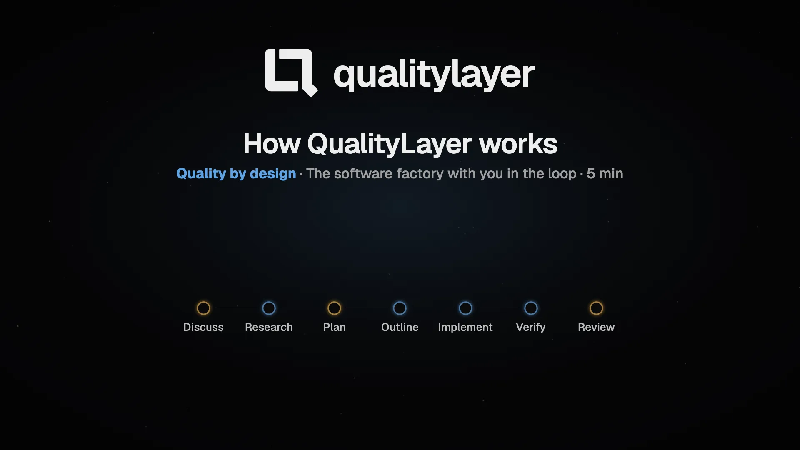
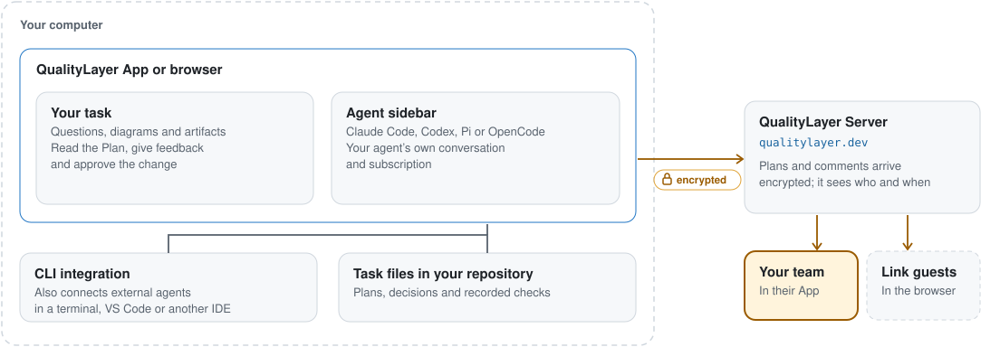
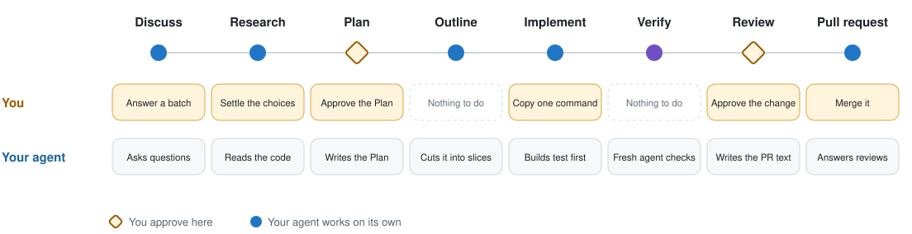
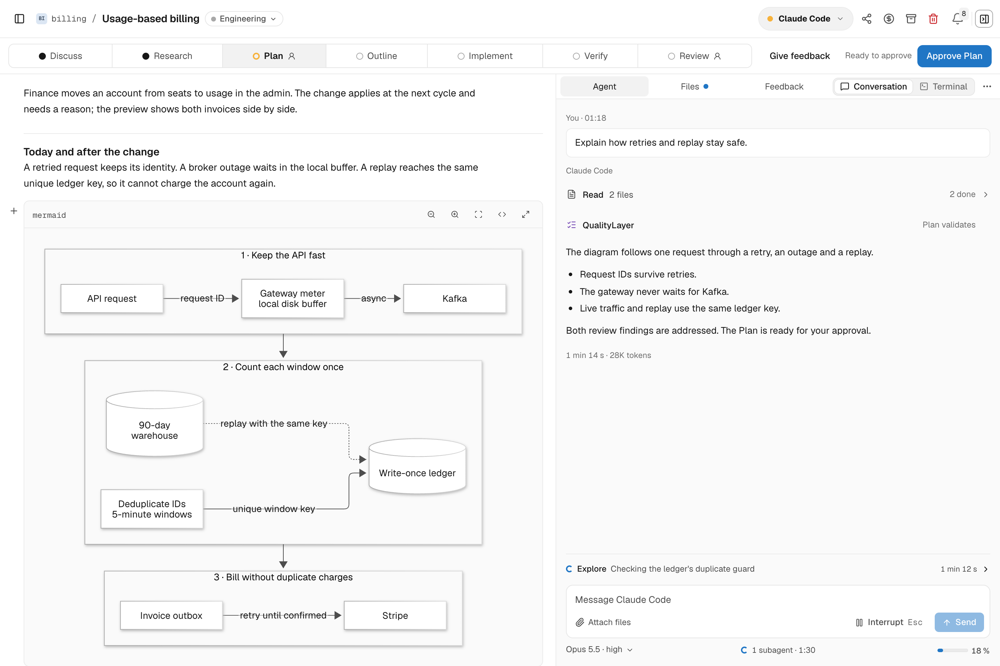
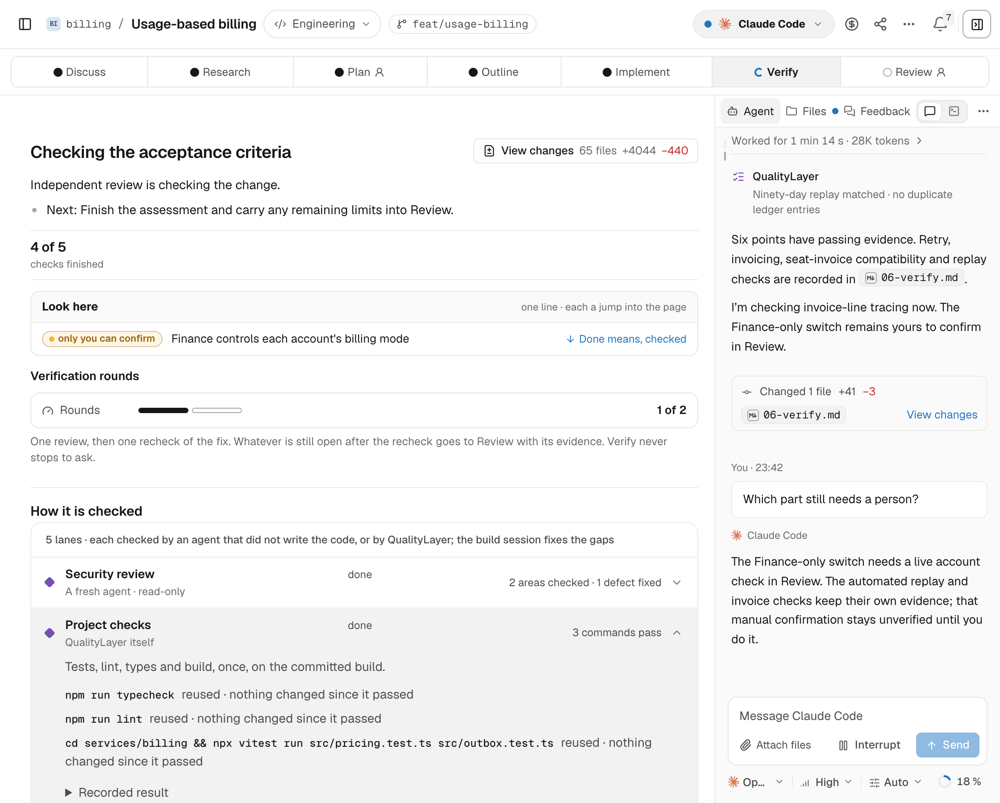

<div align="center">

<picture>
  <source media="(prefers-color-scheme: dark)" srcset="docs/site/public/brand/qualitylayer-mark.svg">
  
</picture>

# QualityLayer

### The software factory for your coding agents

You approve one plan before any code is written. Your agent builds it test first.<br>
**Then agents that did not write the code check the result against your request.**

<a href="https://github.com/maxritter/pilot-shell"><picture>
  <source media="(prefers-color-scheme: dark)" srcset="https://img.shields.io/github/stars/maxritter/pilot-shell?style=flat&amp;color=9d6607&amp;labelColor=30363d">
  
</picture></a>
<a href="https://star-history.com/#maxritter/pilot-shell&amp;Date"><picture>
  <source media="(prefers-color-scheme: dark)" srcset="https://img.shields.io/badge/Star_History-chart-6f4fc2?labelColor=30363d">
  
</picture></a>
<a href="https://github.com/maxritter/pilot-shell/releases"><picture>
  <source media="(prefers-color-scheme: dark)" srcset="https://img.shields.io/github/downloads/maxritter/pilot-shell/total?color=2076c5&amp;labelColor=30363d">
  
</picture></a>
<a href="https://github.com/maxritter/pilot-shell/pulls"><picture>
  <source media="(prefers-color-scheme: dark)" srcset="https://img.shields.io/badge/PRs-welcome-2076C5.svg?labelColor=30363d">
  
</picture></a>

<a href="https://qualitylayer-media.max-ritter.workers.dev/overview.mp4"></a>

<sub>Watch <a href="https://qualitylayer-media.max-ritter.workers.dev/overview.mp4">How QualityLayer works</a> · 5 minutes</sub>

<p>
  <a href="#install">Install</a> •
  <a href="#why">Why</a> •
  <a href="#local">Local first</a> •
  <a href="#how">How it works</a> •
  <a href="#team">Teams</a> •
  <a href="https://qualitylayer.dev/docs/">Docs</a> •
  <a href="https://qualitylayer.dev">Website</a> •
  <a href="https://github.com/maxritter/pilot-shell/releases">Changelog</a>
</p>

**[Download the App](https://qualitylayer.dev/download)** for macOS, Windows or Linux. On a server, in WSL or in a container:

```bash
curl -fsSL https://qualitylayer.dev/install.sh | bash
```

**For Claude Code and Codex · terminal, desktop app or IDE · your own subscription · 7-day trial**

</div>

---

> [!TIP]
> **QualityLayer's open design companion:** [Open Claude Design](https://github.com/maxritter/open-claude-design) connects Claude Design to the coding agent you already use, with codebase-grounded creation and conflict-aware synchronization. Together with [Impeccable](https://github.com/pbakaus/impeccable), product context, visual iteration, deterministic checks, and engineering verification work as one design layer.

---

<h2 id="why">Why QualityLayer</h2>

**Coding agents write code fast, but even the best models don't keep a codebase healthy on their own.** Each change passes its tests and still leaves something behind: a copy, a workaround, code nobody reads. QualityLayer works inside Claude Code or Codex, in the terminal, the desktop app or your IDE, and brings the decisions back to you in the QualityLayer App.

- You approve one plan before any code, written after agents have read how your code works today.
- Your agent builds it test first, and QualityLayer records every test run itself.
- Agents that did not write the code check each point of your request against the running program.
- Your agent settles routine choices and records them. Only real decisions come to you.
- You see the time and estimated cost of every step, and teammates can comment while the plan is still cheap to change.

QualityLayer is for medium and large changes. When a request turns out too small for a plan, your agent closes the task with a ready prompt for the plain agent.

---

<h2 id="local">Runs on what you already have</h2>

QualityLayer is a command line your coding agent calls, plus the QualityLayer App on your computer. There is nothing else to host and no new place for your code.

- **Where you work.** Keep working in the terminal, the Claude Code or Codex desktop app, VS Code or JetBrains. QualityLayer connects to the agent you already run there.
- **Your subscription.** Your agents run on the Claude or ChatGPT plan, or the API key, that you pay for today. QualityLayer charges only for itself, never for model usage.
- **Your files.** Every step writes one Markdown file in your repository, so you can read, diff and commit the plan, its decisions and the test records. The App reads the same files.
- **Private by default.** QualityLayer never sends your code and sends no usage events. Share a task with your team and it is encrypted on your computer before it leaves.

<picture>
  <source media="(prefers-color-scheme: dark)" srcset="docs/docusaurus/static/img/diagrams/architecture-dark.svg">
  
</picture>

<details>
<summary><b>What leaves your computer</b></summary>

Your coding agent talks to its model provider exactly as it does today. QualityLayer itself contacts its server only for your licence, the workflow texts your agent follows and updates. Optional sharing encrypts the shared documents and comments on your computer before sending them; your code, diff and interactive design pages stay local. See [files and privacy](https://qualitylayer.dev/docs/reference/files#privacy).

</details>

---

<h2 id="install">Getting started</h2>

### What you need

A coding agent. The App sets up Claude Code and Codex for you; any other agent that runs shell commands can [connect by hand](https://qualitylayer.dev/docs/agents/other). Start your agent once before you install, so its folder (`~/.claude` or `~/.codex`) exists.

Every install starts a 7-day trial. Solo gives one developer the full workflow; Team adds shared plans, teammate feedback and change review. Manage your licence at [qualitylayer.dev/billing](https://qualitylayer.dev/billing). Coming from Pilot Shell 11, its updater moves you over, and your plans and paid licence carry over.

### Install

**[Download the App](https://qualitylayer.dev/download)** and open it. Its first start sets up the command line, your agents and your licence, and the App keeps itself up to date.

<details>
<summary><b>Install from a terminal (server, WSL, container)</b></summary>

```bash
curl -fsSL https://qualitylayer.dev/install.sh | bash      # macOS, Linux, WSL
irm https://qualitylayer.dev/install.ps1 | iex             # Windows PowerShell
```

Without a screen you get the command line only and open the printed link in a browser. Updates, uninstall and specific versions are in the [install guide](https://qualitylayer.dev/docs/install).

</details>

<details>
<summary><b>What gets installed</b></summary>

The App sets up the command line and your agent skills. See the [install guide](https://qualitylayer.dev/docs/install) for configuration changes, updates and uninstall.

`/ql` is the only command you need: QualityLayer adds no other command that starts with ql. The `agent-peers` skill works on its own when you ask one agent session to message another.

</details>

### Your first task

Describe a change to your agent in any repository:

```text
/ql retry failed webhooks, and stop after a few tries     # Claude Code
$ql retry failed webhooks, and stop after a few tries     # Codex
```

Or click **+ New** in the App. The unreleased App-run candidate adds **Here in the App**: choose your agent and repository, write the request and start its interactive window. **In my terminal** keeps the command you can copy into your terminal, editor or agent app. App runs on Windows are planned for later; use the terminal option there.

Your agent asks each decision in the App, and its terminal shows a single line while it waits. It sends independent questions together in batches, and **Your turn** shows one focused question with its context. You can answer in any order or press **Skip for now**; each answer reaches the agent immediately. Approving the plan is a separate action you take once you have read it.

After you approve, Implement offers the same two places to run. In the unreleased candidate, choose Claude Code or Codex, select **Here in the App**, then press **Start the build**. The terminal option still shows the launch command for a fresh session. Your agent then works on its own until the final review. If it needs a login or secret only you have, it asks in **Your turn** while other slices keep building.

For example, **In my terminal** shows `claude --model opus --effort high "/ql implement retry-webhooks"`, which starts the build in a fresh session. Run the command in the task's checkout.

An App run keeps working when you fold its window or navigate away. Reopen it to type, paste or answer the agent's own permission prompts. **Interrupt** sends the agent's interrupt key; **Stop** ends the run. A paired phone watches by default, and the computer's key-paired session controls who may type. Settings chooses whether quitting the App keeps runs going or stops them; an update preserves them. See [App runs](https://qualitylayer.dev/docs/app#agent-runs) for permissions, resume and other agents. This candidate is under local verification and has not been released.

QualityLayer runs only when you ask for it: with `/ql` (`$ql` in Codex), `/ql implement`, or a request to resume a named task. Everything else works as before.

---

<h2 id="how">How it works</h2>

### Eight steps from request to pull request

Every task takes the same eight steps, in order. The first seven each write one Markdown file in the task's folder; the last follows the pull request until you merge it. You approve twice: the plan before any code, and the finished change. QualityLayer works on the branch you have checked out and never switches it.

<picture>
  <source media="(prefers-color-scheme: dark)" srcset="docs/docusaurus/static/img/diagrams/flow-pr-dark.svg">
  
</picture>

**Agree on the plan.** In Discuss you settle what done means; a bug is reproduced first. Agents research the code, and the Plan shows the design, diagrams and checks, sized to the change; a comment you leave is answered within a minute. A risky Plan is read by another agent while you read it; Approve unlocks once its findings are folded in. The build session writes the Outline from the approved Plan, then builds it. A small task's Outline can be ready while you read the Plan, so its build starts sooner.

<picture>
  <source media="(prefers-color-scheme: dark)" srcset="docs/site/public/product/plan-dark.webp">
  
</picture>
<sub>Example task in a fictional project: usage-based billing across nine services.</sub>

**Build and prove it.** Your agent builds slice by slice, each starting with a failing test. In Verify, agents that did not write the code check every point of your request, and a live checklist keeps each point next to its evidence. Review walks you through the change before the pull request opens, and the task stays open until it is merged.

<picture>
  <source media="(prefers-color-scheme: dark)" srcset="docs/site/public/product/verify-dark.webp">
  
</picture>
<sub>Example task in a fictional project: verifying usage-based billing.</sub>

### Two levels

**Engineering**, the default, starts each task from the full technical plan. **Product** starts from a product brief that becomes a PRD, with the engineering detail folded away. Pick one at **Setup**, change it in **Settings › Workflow**, or switch one task from the task header; the steps and checks stay the same. [How the levels differ](https://qualitylayer.dev/docs/#two-levels).

### Your models, your cost

Choose which agent and model plans, builds and checks. The App shows each step's time and estimated cost. See [the App guide](https://qualitylayer.dev/docs/app) for the screens and controls.

---

<h2 id="team">Bring your team in</h2>

With a Team plan, you can ask a teammate about any passage of the plan. They get a Slack message, answer in their own App or let their own agent draft the answer with `/ql answer`, and the answer goes to your agent. After the build, they comment on the finished change. Sharing is encrypted on your computer, and your code stays local. Solo works fully without a team. See [team plans](https://qualitylayer.dev/docs/team/plans), [teammates' agents](https://qualitylayer.dev/docs/team/agents) and [change review](https://qualitylayer.dev/docs/team/changes).

Claude Code and Codex sessions on your computer can also message each other, to ask for a review or hand over a task.

---

## Documentation

- [Install](https://qualitylayer.dev/docs/install), [your first task](https://qualitylayer.dev/docs/first-task), [other agents](https://qualitylayer.dev/docs/agents/other) and [moving from Pilot Shell 11](https://qualitylayer.dev/docs/moving-from-pilot-shell)
- The steps: [Discuss](https://qualitylayer.dev/docs/steps/discuss), [Research](https://qualitylayer.dev/docs/steps/research), [Plan](https://qualitylayer.dev/docs/steps/plan), [Outline](https://qualitylayer.dev/docs/steps/outline), [Implement](https://qualitylayer.dev/docs/steps/implement), [Verify](https://qualitylayer.dev/docs/steps/verify), [Review](https://qualitylayer.dev/docs/steps/review), [Pull request](https://qualitylayer.dev/docs/steps/pull-request)
- [The App](https://qualitylayer.dev/docs/app), [commands](https://qualitylayer.dev/docs/reference/commands), [settings](https://qualitylayer.dev/docs/reference/settings), and [files and privacy](https://qualitylayer.dev/docs/reference/files)
- [The film](https://qualitylayer-media.max-ritter.workers.dev/overview.mp4) and every step with a screenshot on [the website](https://qualitylayer.dev/#tour)

## Changelog

See [the changelog](https://qualitylayer.dev/docs/changelog) or [GitHub Releases](https://github.com/maxritter/pilot-shell/releases).

## Contributing

Found a bug or missing a feature? [Open an issue](https://github.com/maxritter/pilot-shell/issues).

## License

See [LICENSE](LICENSE).

---

<div align="center">

**The software factory for your coding agents**

Made by [Max Ritter](https://maxritter.net)

</div>

[osai-verify: 8d67182dee08d42091c5]: #
