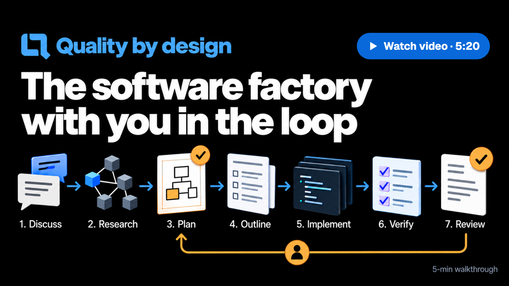
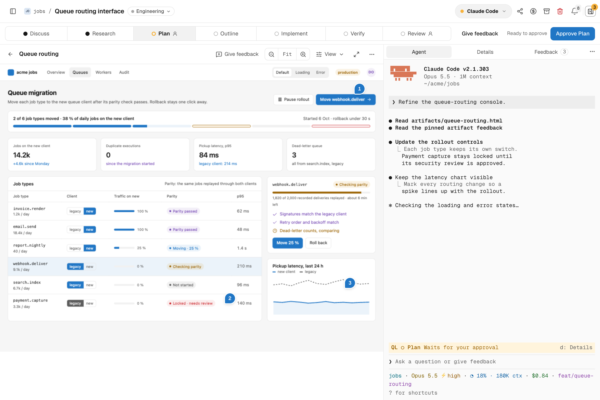

<div align="center">

<picture>
  <source media="(prefers-color-scheme: dark)" srcset="docs/site/public/brand/qualitylayer-mark.svg">
  
</picture>

# QualityLayer

## The software factory with you in the loop

**Plan each change visually, then let your agents build and verify it.**<br>
Work side by side in the App or browser, or use your favourite terminal or IDE.

<a href="https://github.com/maxritter/qualitylayer"></a>
<a href="https://star-history.com/#maxritter/qualitylayer&amp;Date"></a>
<a href="https://github.com/maxritter/qualitylayer/releases"></a>
<a href="https://github.com/maxritter/qualitylayer/pulls"></a>

<p>
  <a href="#install">Install</a> •
  <a href="#features">Features</a> •
  <a href="https://qualitylayer.dev/docs/">Docs</a> •
  <a href="https://qualitylayer.dev">Website</a> •
  <a href="https://qualitylayer.dev/docs/changelog">Changelog</a>
</p>

**[Download the App](https://qualitylayer.dev/download)** for macOS, Windows or Linux. 7-day trial.

<br>

<a href="https://qualitylayer-media.max-ritter.workers.dev/overview-v2026102001.mp4" aria-label="Watch the QualityLayer walkthrough, 5 minutes 20 seconds"></a>

**[▶ Watch the 5:20 walkthrough](https://qualitylayer-media.max-ritter.workers.dev/overview-v2026102001.mp4)**

</div>

---

## Why QualityLayer

> “With QualityLayer, developing software with agents finally feels like doing real engineering again.”
>
> *An engineer who uses QualityLayer*

QualityLayer keeps design decisions and verification visible while your agents work.

| You get | How it works |
| --- | --- |
| **Your own agent and plan** | Claude Code, Codex, Cursor and four more run on the subscription or API key you already have. QualityLayer never charges for AI usage. |
| **A design you can review** | Comment on diagrams and clickable screens, then approve the Plan before code changes. |
| **Small, tested changes** | Your agent builds in slices, each starting with a failing test, and fixes what fails itself. |
| **An independent check** | A fresh agent that did not write the code adds missing tests and rules on each point of your request on the running program. Anything it cannot verify stays open for your decision in Review. |
| **Code health checks** | Local checks flag complex functions and deeply nested code for your agent to review. Ask for a wider check to find duplication. [Code health](https://qualitylayer.dev/docs/reference/code-health). |
| **Visible decisions and effort** | Each step records its decisions and results in your repository, with time and estimated model cost shown in the App. |

Choose **Feature** or **Bugfix** for a change that needs an approved Plan and recorded verification. Choose **Chat** for a direct conversation with Claude Code or Codex, adding QualityLayer tools when you need them.

---

<h2 id="install">Getting Started</h2>

### Prerequisites

- **A coding agent:** Claude Code, Codex, Cursor, Grok, Antigravity, Pi or OpenCode, installed and signed in. Choose it in the App or browser. [Other agents](https://qualitylayer.dev/docs/agents/other) connect through the CLI.
- **Your own subscription** (Claude or ChatGPT plan, or API key). QualityLayer never charges for model usage.
- **Git** and a repository.

### Installation

**[Download the App](https://qualitylayer.dev/download)** and open it. Setup activates your licence or starts the trial, installs the `qualitylayer` command and connects your agents. On a server, in WSL or in a container:

```bash
curl -fsSL https://qualitylayer.dev/install.sh | bash      # macOS, Linux, WSL
irm https://qualitylayer.dev/install.ps1 | iex             # Windows PowerShell
```

The App updates itself; without it, run `qualitylayer update`. [Installation guide](https://qualitylayer.dev/docs/install).

<details>
<summary><b>Uninstalling</b></summary>

`qualitylayer uninstall` undoes what the installer changed; your plans stay. On Windows, even when the App is gone:

```powershell
& ([scriptblock]::Create((irm https://qualitylayer.dev/install.ps1))) -Uninstall
```

</details>

<details>
<summary><b>Coming from Pilot Shell 11</b></summary>

Run `pilot update` to install QualityLayer v12, or download it directly. Keep Pilot Shell 11 alongside it until you are ready to remove it; your paid licence works with both. Import memories per project when you are ready. [Moving from Pilot Shell](https://qualitylayer.dev/docs/moving-from-pilot-shell).

</details>

### First Steps

In the App or browser, choose **+ New**, then **Chat**, **Feature** or **Bugfix**. Pick your repository and agent, and describe what you need.

**Chat** opens a full-width conversation with Claude Code or Codex, without workflow steps or approval gates. Answer supported questions in the App and follow its task list above the composer when it has one. Ask it to save a plan, build in slices, make artifacts, run checks or request an independent review. In a terminal, ask: “Using QualityLayer, chat about retrying failed webhooks.”

Choose **Start the workflow**, then Feature or Bugfix, when the work needs the full process. The same task enters Discuss with its conversation history, saved plan and artifacts as context. The workflow's Plan approval governs subsequent work. [Chat guide](https://qualitylayer.dev/docs/chat).

For a **Feature** or **Bugfix**, describe the change:

```text
Plan retries for failed webhooks and stop after a few tries.
```

1. Answer your agent's questions and comment on the Plan beside its conversation.
2. Approve the Plan and start the build. Your agent continues through Outline, Implement and Verify.
3. Review the result and its evidence. Checks that need you, or could not run, stay open for your decision.

| Where you work | How to start |
| --- | --- |
| **App or browser** | Choose **In the App** to keep the agent beside the task. |
| **Your terminal or IDE** | Choose **In my terminal** to copy the request, or ask there: “Using QualityLayer, plan retries for failed webhooks.” |
| **Another agent** | Agents that run shell commands can use the CLI. [Supported agents](https://qualitylayer.dev/docs/agents/native). |

To continue elsewhere, stop the active run, then ask: “Using QL, continue verification of task retry-webhooks.” Your Plan, changes and evidence stay with the task.

QualityLayer runs only when you ask for it. [Your first task](https://qualitylayer.dev/docs/first-task).

### Skills your agent gets

Setup installs six skills into each connected agent. They teach it to drive the `qualitylayer` command line instead of guessing: which step comes next, what needs your approval, and how to reach other agent sessions. Ask in plain language, naming QualityLayer or QL; your agent picks the skill.

| Skill | What it does |
| --- | --- |
| `ql-workflow` | Plan, build, verify and review a change |
| `ql-artifact` | Create and revise mockups, diagrams and clickable pages |
| `ql-manage` | Find tasks and manage memory, sharing, settings and setup |
| `ql-peer` | Coordinate other agent sessions on your computer |
| `ql-quality` | Review code complexity, structure and duplication |
| `ql-chat` | Start or continue a Chat, a conversation without workflow steps |

Only `ql-workflow` starts the planning and build workflow; the others work on their own. [More about the skills](https://qualitylayer.dev/docs/agents/native#the-six-skills).

---

<h2 id="features">The Workflow</h2>

Each step writes a Markdown file in your repository. Your agent follows a short instruction for each step and decides how to carry it out. Small changes keep a short Plan and one build step; larger work gets the detail it needs. Bugs start with reproduction and diagnosis. Read questions, decisions and results in the App. You approve the Plan and the finished change; QualityLayer pushes only with your approval and leaves merging to you.

<picture>
  <source media="(prefers-color-scheme: dark)" srcset="docs/docusaurus/static/img/diagrams/flow-pr-dark.svg">
  
</picture>

| Step | What happens |
|---|---|
| [Discuss](https://qualitylayer.dev/docs/steps/discuss) | Settles what done means and clarifies a bug report |
| [Research](https://qualitylayer.dev/docs/steps/research) | Agents read how your code works today; a bug is reproduced and diagnosed here |
| [Plan](https://qualitylayer.dev/docs/steps/plan) | Diagrams, clickable artifacts and checks, **approved by you** |
| [Outline](https://qualitylayer.dev/docs/steps/outline) | The build session splits the approved Plan into small slices |
| [Implement](https://qualitylayer.dev/docs/steps/implement) | Your agent builds test first, fixes what fails and decides when it is ready |
| [Verify](https://qualitylayer.dev/docs/steps/verify) | The project checks, then a fresh agent rules on every point of your request, with its evidence |
| [Review](https://qualitylayer.dev/docs/steps/review) | A walkthrough of the change, **approved by you** |
| [Pull request](https://qualitylayer.dev/docs/steps/pull-request) | Failing checks and routine review threads fixed; the task stays open until you merge |

### Two levels

**Engineering** starts with a technical plan. **Product** starts with a brief that becomes a product requirements document. Choose at Setup or change it in Settings › Workflow or the task header. [How they differ](https://qualitylayer.dev/docs/#two-levels).

## QualityLayer App

<a href="docs/site/public/product/plan-dark.webp">
  <picture>
    <source media="(prefers-color-scheme: dark)" srcset="docs/site/public/product/plan-dark.webp">
    
  </picture>
</a>

| In the App | What you can do |
| --- | --- |
| **Chat or a planned task** | Chat is a direct conversation with Claude Code or Codex. Feature and Bugfix follow the seven-step workflow, with your two approvals. |
| **Conversation and terminal** | Read the agent's conversation or its terminal beside the task. Answer questions and pin feedback. |
| **Artifacts** | Try mockups, diagrams and clickable pages before any code exists. |
| **Checks and code review** | See each step's checks and evidence, then read the change like a pull request and comment on any line. |
| **Agent controls and usage** | Choose agent, model, effort, permission mode and branch for each run, and see how much of your Claude Code and Codex plans is left. More in [Settings](https://qualitylayer.dev/docs/reference/settings). |
| **Memory and team** | Reuse lessons across tasks through Git ([Project memory](https://qualitylayer.dev/docs/memory)). Ask teammates over Slack and review shared work with a [Team plan](https://qualitylayer.dev/docs/team/plans). |

QualityLayer keeps task files on your computer and encrypts shared tasks first. Your coding agent uses its own provider. [Files and privacy](https://qualitylayer.dev/docs/reference/files#privacy).

[Explore the App →](https://qualitylayer.dev/docs/app)

## Artifacts

An artifact is a mockup, diagram or clickable page your agent draws, so you can try a flow before any code exists. Click a spot to say what should change; your agent edits the page and answers. Keep the ones every task builds on in your repository. [Artifacts](https://qualitylayer.dev/docs/artifacts).

<a href="docs/site/public/product/artifact-dark.webp">
  <picture>
    <source media="(prefers-color-scheme: dark)" srcset="docs/site/public/product/artifact-dark.webp">
    
  </picture>
</a>

---

## Documentation

Guides for [getting started](https://qualitylayer.dev/docs/), [commands](https://qualitylayer.dev/docs/reference/commands) and [settings](https://qualitylayer.dev/docs/reference/settings).

---

## Changelog

See [the changelog](https://qualitylayer.dev/docs/changelog) or [GitHub Releases](https://github.com/maxritter/qualitylayer/releases).

---

## Contributing

Found a bug or missing a feature? [Open an issue](https://github.com/maxritter/qualitylayer/issues).

---

## License

See [LICENSE](LICENSE).

---

<div align="center">

**Quality by design.** The software factory with you in the loop.

Made by [Max Ritter](https://maxritter.net)

</div>

[osai-verify: 8d67182dee08d42091c5]: #
