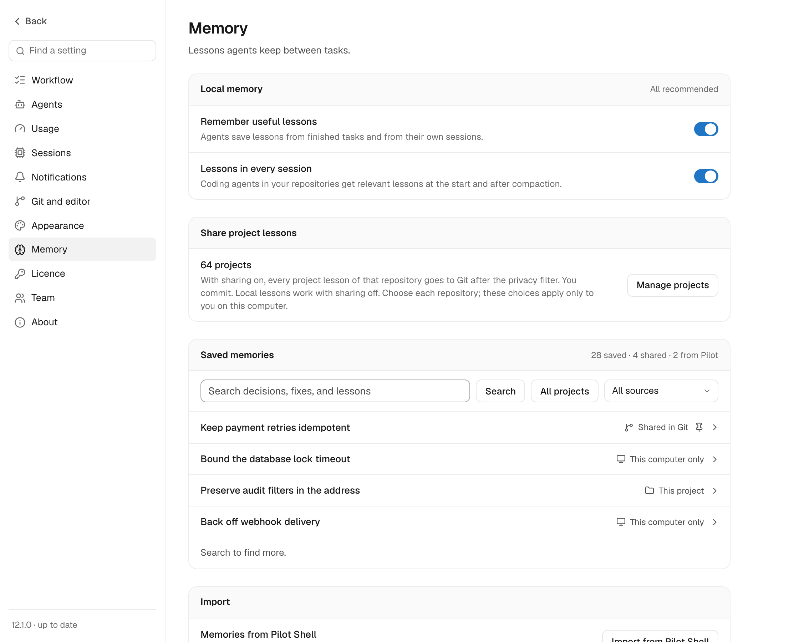

<div align="center">

<picture>
  <source media="(prefers-color-scheme: dark)" srcset="docs/site/public/brand/qualitylayer-mark.svg">
  
</picture>

# QualityLayer

### The software factory for your coding agents

You approve one plan before any code is written. Your agent builds it test first.<br>
**Then agents that did not write the code check the result against your request.**

<a href="https://github.com/maxritter/pilot-shell"><picture>
  <source media="(prefers-color-scheme: dark)" srcset="https://img.shields.io/github/stars/maxritter/pilot-shell?style=flat&amp;color=9d6607&amp;labelColor=30363d">
  
</picture></a>
<a href="https://star-history.com/#maxritter/pilot-shell&amp;Date"><picture>
  <source media="(prefers-color-scheme: dark)" srcset="https://img.shields.io/badge/Star_History-chart-6f4fc2?labelColor=30363d">
  
</picture></a>
<a href="https://github.com/maxritter/pilot-shell/releases"><picture>
  <source media="(prefers-color-scheme: dark)" srcset="https://img.shields.io/github/downloads/maxritter/pilot-shell/total?color=2076c5&amp;labelColor=30363d">
  
</picture></a>
<a href="https://github.com/maxritter/pilot-shell/pulls"><picture>
  <source media="(prefers-color-scheme: dark)" srcset="https://img.shields.io/badge/PRs-welcome-2076C5.svg?labelColor=30363d">
  
</picture></a>

<a href="https://qualitylayer-media.max-ritter.workers.dev/overview.mp4"></a>

<sub>Watch <a href="https://qualitylayer-media.max-ritter.workers.dev/overview.mp4">How QualityLayer works</a> · 5 minutes</sub>

<p>
  <a href="#install">Install</a> •
  <a href="#why">Why</a> •
  <a href="#local">Local first</a> •
  <a href="#how">How it works</a> •
  <a href="#team">Teams</a> •
  <a href="https://qualitylayer.dev/docs/">Docs</a> •
  <a href="https://qualitylayer.dev">Website</a> •
  <a href="https://github.com/maxritter/pilot-shell/releases">Changelog</a>
</p>

**[Download the App](https://qualitylayer.dev/download)** for macOS, Windows or Linux. On a server, in WSL or in a container:

```bash
curl -fsSL https://qualitylayer.dev/install.sh | bash
```

**For Claude Code and Codex · terminal, desktop app or IDE · your own subscription**

</div>

---

> [!TIP]
> **Design companion:** [Open Claude Design](https://github.com/maxritter/open-claude-design) connects Claude Design to the coding agent you already use. Pair it with [Impeccable](https://github.com/pbakaus/impeccable) for designs grounded in your codebase.

---

<h2 id="why">Why QualityLayer</h2>

Coding agents write code fast, but each change still leaves copies, workarounds and dead code behind. QualityLayer runs inside Claude Code or Codex and brings the real decisions to you in the App.

- You approve one plan, written after agents read your code.
- Your agent builds it test first; QualityLayer records every test run.
- Agents that did not write the code check each point of your request against the running program.
- Every step shows its time and estimated cost.
- Ask for a mockup, diagram or clickable design and compare versions in the App. [Designs](https://qualitylayer.dev/docs/designs)

Made for medium and large changes. A request too small for a plan gets a ready prompt for your plain agent.

---

<h2 id="local">Runs on what you already have</h2>

| | |
| --- | --- |
| **Where you work** | Terminal, Claude Code or Codex desktop app, VS Code or JetBrains |
| **Your subscription** | Your Claude or ChatGPT plan, or API key. QualityLayer never charges for model usage |
| **Your files** | Each step writes one Markdown file in your repository, to read, diff and commit |
| **Private by default** | Your code and usage data stay on your computer. Shared tasks are encrypted first |

<picture>
  <source media="(prefers-color-scheme: dark)" srcset="docs/docusaurus/static/img/diagrams/architecture-dark.svg">
  
</picture>

<details>
<summary><b>What leaves your computer</b></summary>

Only licence checks, workflow texts and updates, plus anything you share, encrypted on your computer first. Source files, diffs and terminal output stay local. [Files and privacy](https://qualitylayer.dev/docs/reference/files#privacy).

</details>

### Project memory

Claude Code and Codex reuse lessons from earlier tasks. Search or retire them in Settings, and choose which repositories share them through Git. No extra key or service. [Project memory](https://qualitylayer.dev/docs/memory).

<picture>
  <source media="(prefers-color-scheme: dark)" srcset="docs/site/public/product/memory-dark.webp">
  
</picture>

---

<h2 id="install">Getting started</h2>

**You need** Claude Code or Codex, started once so `~/.claude` or `~/.codex` exists. Other agents that run shell commands can [connect by hand](https://qualitylayer.dev/docs/agents/other).

1. **[Download the App](https://qualitylayer.dev/download)** and open it. It sets up the command line, your agents and your licence, and keeps itself up to date.
2. Start the 7-day trial or activate your licence. Solo is the full workflow for one developer; Team adds shared plans, teammate feedback and change review. [Billing](https://qualitylayer.dev/billing).

Coming from Pilot Shell 11? Its updater moves you over with your plans and licence.

<details>
<summary><b>Install from a terminal (server, WSL, container)</b></summary>

```bash
curl -fsSL https://qualitylayer.dev/install.sh | bash      # macOS, Linux, WSL
irm https://qualitylayer.dev/install.ps1 | iex             # Windows PowerShell
```

Without a screen you get the command line and open the printed link in a browser. Updates and uninstall: [install guide](https://qualitylayer.dev/docs/install).

</details>

<details>
<summary><b>What gets installed</b></summary>

The command line and your agent skills. `/ql` is the only command you need: QualityLayer adds no other command that starts with ql. The `agent-peers` skill works on its own when you ask one agent session to message another.

</details>

### Your first task

```text
/ql retry failed webhooks, and stop after a few tries     # Claude Code
$ql retry failed webhooks, and stop after a few tries     # Codex
```

Or click **+ New** in the App, which runs your agent in an App window or gives you the command for your terminal.

1. **Answer in the App.** Your agent asks each decision in the App, and its terminal shows a single line while it waits. Independent questions arrive as a batch in **Your turn**, one focused question at a time. Answer in any order or press **Skip for now**; each answer reaches your agent immediately.
2. **Approve the Plan** once you have read it.
3. **Start the build** in the App, or run the command it shows, such as `claude --model opus --effort high "/ql implement retry-webhooks"`, which starts the build in a fresh session. Your agent works on its own until you review the finished change. If it needs a login or secret only you have, it asks in **Your turn** while other slices keep building.

QualityLayer runs only when you ask for it with `/ql` (`$ql` in Codex). Everything else works as before.

---

<h2 id="how">How it works</h2>

### Eight steps from request to pull request

Each of the first seven steps writes one Markdown file; the last follows the pull request until you merge. You approve twice: the plan, and the finished change. QualityLayer works on your current branch, or a new `ql/<task>` branch if you pick one, and never merges or pushes.

<picture>
  <source media="(prefers-color-scheme: dark)" srcset="docs/docusaurus/static/img/diagrams/flow-pr-dark.svg">
  
</picture>

**Agree on the plan.** Discuss settles what done means; a bug is reproduced first. Agents research the code, and the Plan shows the design, diagrams and checks. Comments get an answer within a minute. A risky Plan is also reviewed by a second agent before you approve.

<picture>
  <source media="(prefers-color-scheme: dark)" srcset="docs/site/public/product/plan-dark.webp">
  
</picture>
<sub>Example task in a fictional project: usage-based billing across nine services.</sub>

**Build and prove it.** Your agent builds in small slices, each starting with a failing test. Verify checks every point of your request and shows the evidence beside it. Review walks you through the change, then the pull request opens. Your agent fixes failing checks, up to three times, and the task stays open until you merge.

<picture>
  <source media="(prefers-color-scheme: dark)" srcset="docs/site/public/product/verify-dark.webp">
  
</picture>
<sub>Example task in a fictional project: verifying usage-based billing.</sub>

### Two levels

**Engineering**, the default, starts from the full technical plan. **Product** starts from a brief that becomes a PRD. Pick one at **Setup**, change it in **Settings › Workflow**, or switch one task in the task header. [How they differ](https://qualitylayer.dev/docs/#two-levels).

### Your rules and models

| | |
| --- | --- |
| **Your rules** | Standing instructions in **Settings › Workflow** reach every step. [Instructions](https://qualitylayer.dev/docs/reference/settings#instructions) |
| **Your models** | Choose the agent and model that plans, builds and checks. [The App](https://qualitylayer.dev/docs/app) |

---

<h2 id="team">Bring your team in</h2>

With a Team plan, ask a teammate about any passage of the plan. They get a Slack message and answer in their App, or let their agent draft it with `/ql answer`. After the build, they comment on the finished change. Your code stays local.

[Team plans](https://qualitylayer.dev/docs/team/plans) · [Teammates' agents](https://qualitylayer.dev/docs/team/agents) · [Change review](https://qualitylayer.dev/docs/team/changes)

---

## Documentation

- [Install](https://qualitylayer.dev/docs/install), [your first task](https://qualitylayer.dev/docs/first-task), [other agents](https://qualitylayer.dev/docs/agents/other) and [moving from Pilot Shell 11](https://qualitylayer.dev/docs/moving-from-pilot-shell)
- The steps: [Discuss](https://qualitylayer.dev/docs/steps/discuss), [Research](https://qualitylayer.dev/docs/steps/research), [Plan](https://qualitylayer.dev/docs/steps/plan), [Outline](https://qualitylayer.dev/docs/steps/outline), [Implement](https://qualitylayer.dev/docs/steps/implement), [Verify](https://qualitylayer.dev/docs/steps/verify), [Review](https://qualitylayer.dev/docs/steps/review), [Pull request](https://qualitylayer.dev/docs/steps/pull-request)
- [The App](https://qualitylayer.dev/docs/app), [commands](https://qualitylayer.dev/docs/reference/commands), [settings](https://qualitylayer.dev/docs/reference/settings), and [files and privacy](https://qualitylayer.dev/docs/reference/files)
- [The film](https://qualitylayer-media.max-ritter.workers.dev/overview.mp4) and every step with a screenshot on [the website](https://qualitylayer.dev/#tour)

## Changelog

See [the changelog](https://qualitylayer.dev/docs/changelog) or [GitHub Releases](https://github.com/maxritter/pilot-shell/releases).

## Contributing

Found a bug or missing a feature? [Open an issue](https://github.com/maxritter/pilot-shell/issues).

## License

See [LICENSE](LICENSE).

---

<div align="center">

**The software factory for your coding agents**

Made by [Max Ritter](https://maxritter.net)

</div>

[osai-verify: 8d67182dee08d42091c5]: #
